# HeroLoop — Seeker edition (Solana Mobile CLOCK IN)

HeroLoop is an idle team RPG: you assemble a hero squad, it fights through locations on its own (also while you are away), and you return to collect rewards, open chests, equip and enchant items and push into dungeons. This repository is the **Seeker edition** built for Solana Mobile: an Android app for the Seeker phone with Solana wallet sign-in and an isolated, SKR-only economy.

> **About this repository.** HeroLoop is developed in our private main repository since July 2026. This is a filtered export of the Seeker edition: it preserves the development chronology and commit dates for the game client, backend and Android app, and leaves out internal operations, infrastructure and planning files. Exported commit IDs differ from the private repository; author identities are normalized and messages and source text are sanitized and translated into English where needed. Work during CLOCK IN (from 8 September 2026) focused on the Android app, Solana wallet sign-in through the Mobile Wallet Adapter and the SKR economy.

## Judges: 60-second check

| What | Where |
| --- | --- |
| Watch | [Demo video](https://youtube.com/shorts/LsFQqYnza3s) |
| Install | [Android APK](https://heroloop.xyz/download/heroloop-seeker-0.2.21-lab-25.apk), SHA-256 `a2898a6e…3d70` |
| Read | [Pitch deck](pitch/HeroLoop-Pitch-Deck.pdf) |
| Verify on chain | [SKR deposit](https://solscan.io/tx/5MYUgZdSNbN9fKZYXPfofZg5nQondpJjWufqwWjtATZGJAfKXjqszttTUiatHqcgoeg1Z5fKB4qhZYpJJmyNmQr6) · [SKR withdrawal](https://solscan.io/tx/4qyiAQMSZen3nQgvKXBrY8h3ubpCuKcjUy6HDR2e2Q6caDJEpQMFgtHDs6FwBMuYUFGPmGzDvZooTKRdQUyQVLZG) |
| Review code | Wallet sign-in `selfhosted/api/siws_verify_endpoint.ts`, SKR ledger `selfhosted/seeker/`, Android `android/seeker-app/` |
| Live vs roadmap | [Live now and roadmap](#live-now-and-roadmap) |

**Demo video:** [https://youtube.com/shorts/LsFQqYnza3s](https://youtube.com/shorts/LsFQqYnza3s)

**Pitch deck:** [pitch/HeroLoop-Pitch-Deck.pdf](pitch/HeroLoop-Pitch-Deck.pdf)

## Judge review guide

1. Build the client and debug APK with the commands below. Both use the hosted Seeker game by default; a local backend is a separate, optional engineering review environment.
2. Start with `android/seeker-app/` for the native WebView and wallet handoff, then `src/game/solanaWalletAuth.ts` for the wallet flow.
3. Review `selfhosted/api/siws_verify_endpoint.ts` for wallet authentication, `selfhosted/api/seeker_edition.ts` for edition boundaries, and `selfhosted/seeker/` for the separate SKR ledger.
4. Run the wallet and SKR tests below. The debug APK and these automated checks are separate from physical-device acceptance of the submitted release APK.

The pitch deck is included in this source snapshot.

**Install the app:** [heroloop-seeker-0.2.21-lab-25.apk](https://heroloop.xyz/download/heroloop-seeker-0.2.21-lab-25.apk) (version 0.2.21, versionCode 25, SHA-256 `a2898a6e7c5c72e7ea4f928f918ba2871914057435d846de4a46240ef2ae3d70`). The installed app updates itself from `https://seeker.heroloop.xyz/download/latest.json` and verifies the SHA-256 before installing.

## Why HeroLoop is different

- **Heroes that mine.** The squad you build in an idle RPG enters real ORE protocol rounds on Solana from inside the game (beta).
- **SKR as the native currency.** One token for the whole edition: deposits, Store, player Market and withdrawals, all checked against the chain.
- **Server-authoritative economy.** A separate double-entry SKR ledger, finalized-receipt verification and exactly-once settlement, not client-side balances.
- **Wallet-native on Seeker.** Mobile Wallet Adapter sign-in with Seed Vault and other wallets; no passwords, no email.
- **A story you play.** A painted, voiced motion comic that hands control back to real combat, gear and summons.

## Screens (Seeker app, phone width)

| Story | Battle | Heroes | Summon |
| --- | --- | --- | --- |
|  | 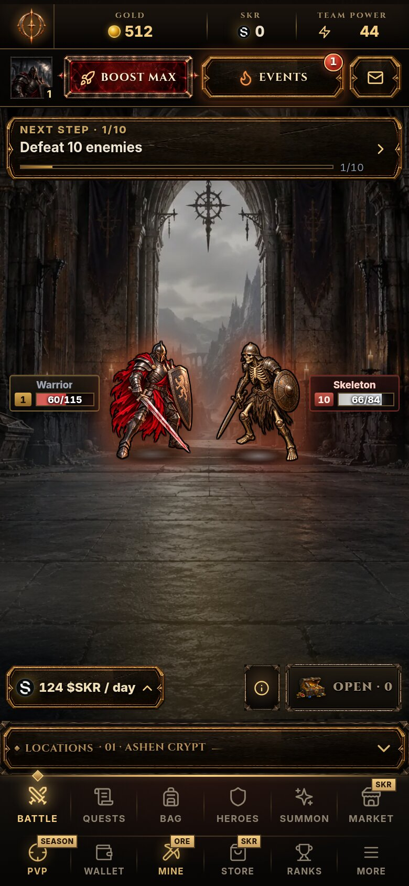 | 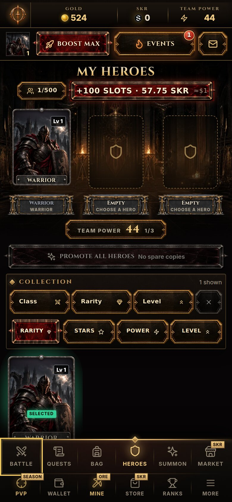 | 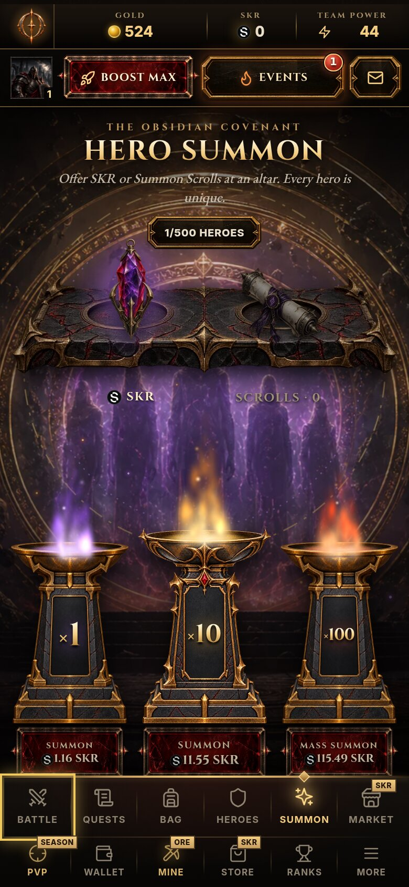 |
| **Events** | **SKR Store** | **ORE Mine** | |
| 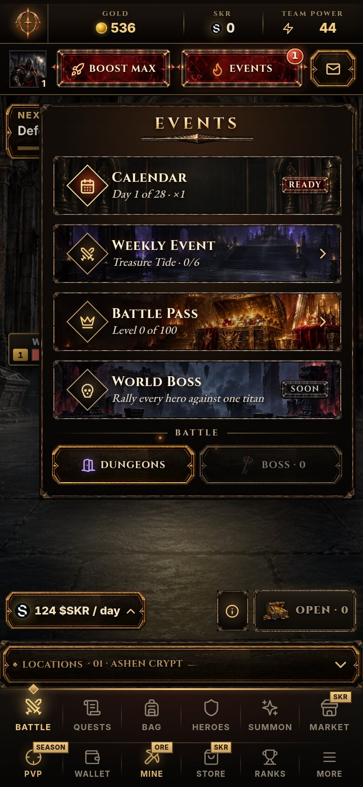 | 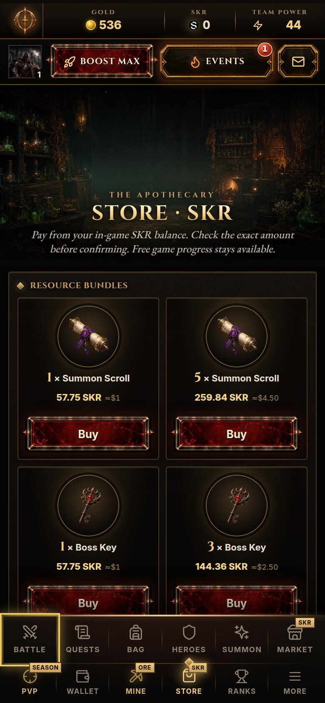 | 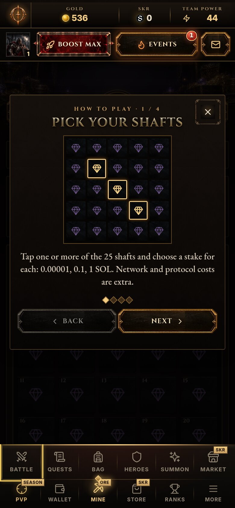 | |

## What is in the box

| Path | What it is |
| --- | --- |
| `src/` | Game client: React + TypeScript + Vite. Combat view, heroes, inventory, chests, dungeons, landing page. |
| `managed/functions/player-sync/` | Shared, deterministic game rules (combat steps, balance, healing) used by both client and server. |
| `selfhosted/` | Backend: Deno API (`selfhosted/api`), worker, PostgreSQL schema and migrations, Supabase GoTrue for Auth, Docker Compose files. |
| `selfhosted/api/seeker_edition.ts` | Seeker-edition gate: the server refuses actions that do not belong to the SKR-only edition. |
| `selfhosted/seeker/` | SKR double-entry ledger in its own database (`seeker_skr`), separate from game data. |
| `selfhosted/api/skr_quote.ts` | SKR pricing and payment verification (integer minimal units, no floats). |
| `android/seeker-app/` | Native Android app: a full-screen WebView shell whose Mobile Wallet Adapter connects to any installed Solana wallet (Seed Vault, Phantom, Solflare, Backpack). |
| `config/` | Versioned game data: balance tables, enchanting, tutorial quests, feature flags. |

### Solana integration

- **Sign in with Solana** through the Mobile Wallet Adapter (`@solana-mobile/wallet-standard-mobile`). The server issues a one-time challenge and verifies the wallet signature (`SIWS_*` settings) before it creates a session.
- **SKR token** (`SKRbvo6Gf7GondiT3BbTfuRDPqLWei4j2Qy2NPGZhW3`, 6 decimals, mainnet) is the only on-chain token used by this edition; gameplay resources such as Gold remain in-game. Amounts are integers in minimal units; the ledger is idempotent and balanced per event.
- **The server is the authority.** Rewards, balances, inventory and combat results are computed on the server; the client never sends values the server trusts.

### On-chain evidence (Solana mainnet)

Real transactions settled by the Seeker edition's wallet service. Each one is verified as finalized on chain before the SKR ledger records it, and each signature can settle only one ledger event.

| Flow | Date (UTC) | Transaction |
| --- | --- | --- |
| SKR deposit, wallet to game | 2026-10-03 | [`3q2RGvYJ…`](https://solscan.io/tx/3q2RGvYJh8kxeGkKPswqrPoKe1Sn8zHRSh57wznqxKKfaQdfMy9PwFtDRn576VAAaK82kdiFUPHmvejbVF2aH6fF) |
| SKR deposit, wallet to game | 2026-10-12 | [`5MYUgZdS…`](https://solscan.io/tx/5MYUgZdSNbN9fKZYXPfofZg5nQondpJjWufqwWjtATZGJAfKXjqszttTUiatHqcgoeg1Z5fKB4qhZYpJJmyNmQr6) |
| SKR withdrawal, signed payout | 2026-10-04 | [`3YK9zQbH…`](https://solscan.io/tx/3YK9zQbHMsMs2DtYLc98d86ds2pwyxdqRZfHm5yxdzNANKsHKWJVTX9pCC3rDyT1rJbCJ4g4VGnwb8aUajL6pCcC) |
| SKR withdrawal, signed payout | 2026-10-12 | [`4qyiAQMS…`](https://solscan.io/tx/4qyiAQMSZen3nQgvKXBrY8h3ubpCuKcjUy6HDR2e2Q6caDJEpQMFgtHDs6FwBMuYUFGPmGzDvZooTKRdQUyQVLZG) |

These flows were run by the team with two test wallets (`5vWcJZVsh1KTfp8bRMhGawoibYMfMfRu7ZoDdMWZjtWR` and `714yHZvDGqvtDHvmFZMufhECdXVfhPSjEPqFXndKbYwa`). `6a3wjyTn1wqkh1nVYtv3CAisNrbXrHVLP52fUyihenJT` is the game's custody wallet and `4yREaLUn5H1BQUfh9nZpSYnrSU1gzJiXvG2CMcjrS1xQ` the project treasury, which also collects fees. The two test accounts also traded an item with each other on the Market; Market trades settle inside the SKR ledger and need no on-chain transaction.

The verification code is in `selfhosted/seeker/` (deposit intents, finalized-receipt checks, payout outbox) and `selfhosted/api/skr_quote.ts`.

## Wallet flow on a real device

Frames from the demo video, recorded on an Android phone with the release APK.

| Loading | Sign in | MWA approval | Deposit pending | Verified on chain | Payout finalized |
| --- | --- | --- | --- | --- | --- |
| 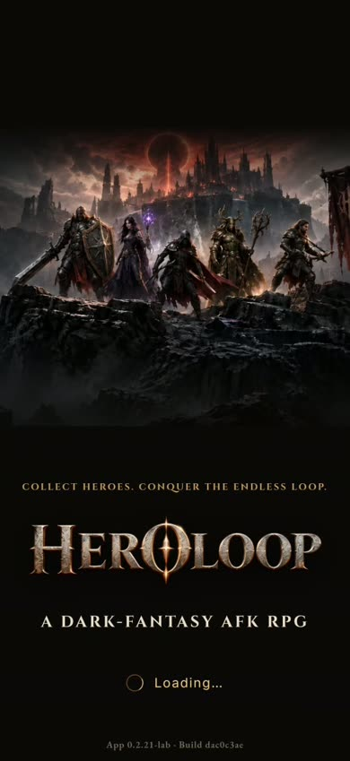 | 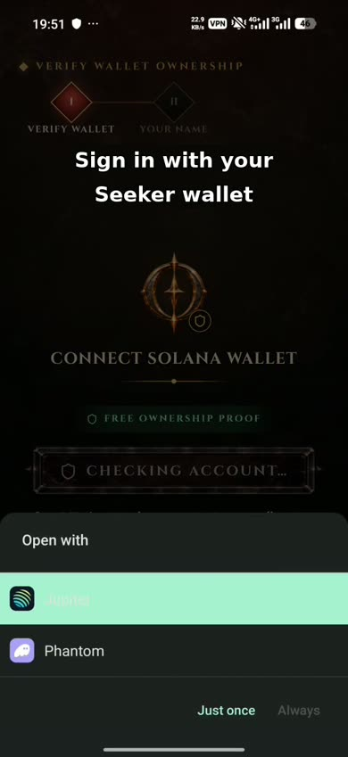 | 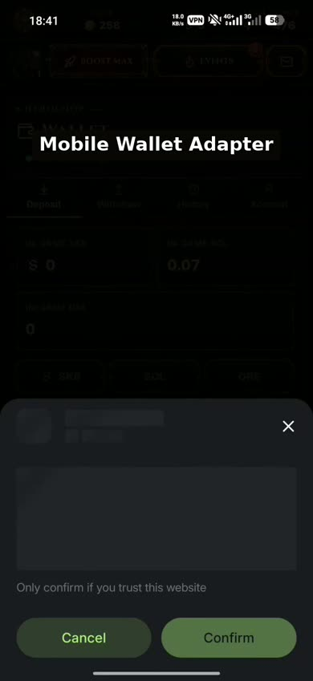 | 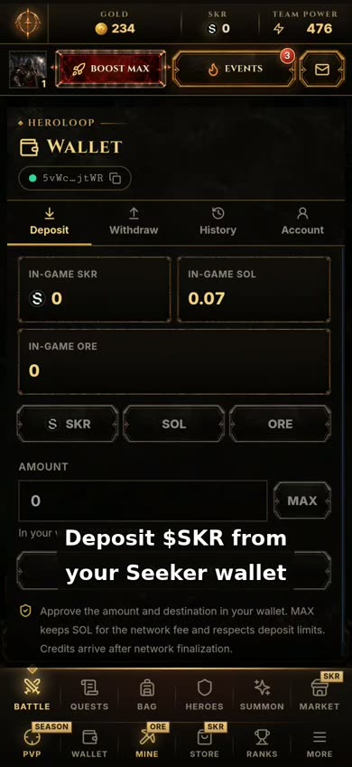 | 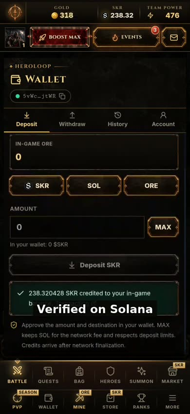 | 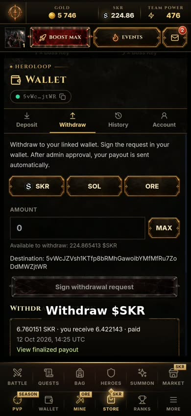 |

## Mobile-native, not a web page in a wrapper

- **Mobile Wallet Adapter session that survives the wallet hand-off.** Android freezes a background app within seconds, so `WalletSessionService` runs a short foreground service while the wallet app is in front; the game receives the wallet's answer instead of hanging.
- **HTTPS only.** `network_security_config.xml` forbids cleartext traffic except the phone's own loopback, which MWA wallets use to answer the game.
- **Edge-to-edge layout.** `MainActivity` passes system bar, display cutout and keyboard insets to the page as CSS variables, so the portrait UI respects Android 15 edge-to-edge and the on-screen keyboard.
- **Android back button** closes the open sheet or dialog first, the way a native app does, instead of leaving the game.
- **Offline banner** when the connection drops, and haptic feedback on Boss entrances and Summon reveals.
- **Verified in-app updates.** `AppUpdater` downloads a new APK from `latest.json`, checks its SHA-256 and installs it through Android's `PackageInstaller`.

## Exactly-once SKR, proven by tests

Examples from the 85 passing Deno tests in `selfhosted/seeker/` and `selfhosted/api/`:

- `duplicate settlement/quote/refund/ledger rows refuse replay inflation`
- `balanced canonical legs reject duplicates, unknown fields and numeric amounts`
- `SKR deposit accepted only with exact amount, payer, reference and mint`
- `deposit window and malformed transactions fail closed`
- `withdrawal reservation reduces available holding immediately; no client balance substitution`
- `pending deploys reuse stored bytes and require actual expiry before releasing reserve`

## Live now and roadmap

**Live in the Seeker app today**

Usage since the Seeker backend opened on 1 October 2026, team testing included: 166 wallet sign-ups, 13,000+ battles and 1,000+ Market listings.

- Android APK with Sign in with Solana through the Mobile Wallet Adapter.
- Story opening (painted, voiced motion comic) with a guided tutorial.
- AFK squad combat with a three-hero formation: 45 heroes (5 classes × 9 rarity tiers), star promotion up to 20 stars, 54 items across 9 gear slots, gear upgrades and enchanting up to +20.
- 20 locations (10 standard, 10 endgame) with content from level 1 to 200; Training Camp and Ranks.
- Bosses, Boss Keys and four-room dungeons; 28-day login calendar and weekly events; Ranks.
- Battle Pass Season 1: 100 levels with Free, Empowered and Collector reward tracks and daily quests.
- SKR economy: on-chain deposits, player Market, SKR Store, BOOST MAX quests and withdrawals (an operator approves each withdrawal; the payout is then signed and verified automatically).
- ORE Mine (beta): heroes enter real ORE protocol rounds paid from the player's in-game SOL.

**Roadmap**

- Endgame hero upgrades (Essence and more) on top of the live endgame locations.
- A sixth hero class, introduced through the story.
- Crafting for the rarest gear: rarity tiers 10 to 12.
- Pets, new skills and auras, plus lots of cosmetics.
- 20 story-driven regions, 200+ enemies and 20 Bosses; chapter two follows Elyra to Blackthorn.
- Season 2: Battle Pass v2, World Boss, PvP arena and Guilds.
- ORE Mine: claiming ORE winnings to the player balance.
- Play to earn: farming SKR through gameplay, scaled by squad power and upgrades.
- New animations, better graphics and sound, performance work.
- Solana dApp Store release.

## Requirements

- Node.js 22 and npm 10
- For the backend: Docker with Compose v2
- For the APK: JDK 17 and an Android SDK with `platforms;android-36` and `build-tools;36.0.0` (`ANDROID_HOME` set)

## 1. Build the game client

```bash
npm ci
npm run build:web        # production bundle in dist/, configured by .env.staging2
```

`.env.staging2` only holds public client settings; it points the client at the hosted Seeker backend `https://seeker.heroloop.xyz`.

## 2. Build the Android APK

```bash
export JAVA_HOME=/path/to/jdk-17
export ANDROID_HOME=/path/to/android-sdk
npm run apk:debug
# -> android/seeker-app/app/build/outputs/apk/debug/app-debug.apk (SHA-256 printed)
```

On a device without the release app installed, install it with `adb install android/seeker-app/app/build/outputs/apk/debug/app-debug.apk`. The debug APK uses the same application ID as the release app and a different signing key, so it cannot update an installed release APK. Use a separate review device; removing an existing installation clears its local app data. The app opens the hosted Seeker game; signing in asks your wallet app to approve the Solana sign-in message. The release APK we submit is signed with a separate key that is not part of this repository.

## 3. Run the backend locally

```bash
npm run backend:local -- up       # Postgres, Auth, wallet Auth, API, worker and the SKR ledger
npm run backend:local -- status
# Destructive local reset: deletes this Compose project's database volume.
npm run backend:local -- down
```

The first `up` generates fresh random secrets into `selfhosted/clockin.env.local` (git-ignored), applies the database baseline, installs the Seeker 200-level progression policy in the local game database and creates the separate SKR ledger schema. Repeated `up` preserves the installed progression policy; an incompatible policy version stops startup. This local helper does not install or migrate a hosted backend. It starts backend services only: `build:web` and the default Android APK continue to use the hosted Seeker game. Connecting a local client also requires routing both `/api/v1/` and `/auth/v1/` to the local services and matching the wallet origin configuration; this helper does not provide that frontend gateway. When it prints `Backend ready`, the API answers on `http://127.0.0.1:28081/api/v1/health` and Auth on `http://127.0.0.1:29999/health`. Ports can be changed with `HL_LOCAL_API_PORT`, `HL_LOCAL_AUTH_PORT` and `HL_LOCAL_DB_PORT`.

## Tests

```bash
npx tsx --tsconfig tsconfig.app.json --test test/solanaWallet*.test.ts test/authTransient.test.ts     # wallet sign-in and session tests
docker run --rm -v "$PWD/selfhosted:/app:ro" -w /app denoland/deno:2.9.4 \
  test --config=/app/deno.json --cached-only seeker/ api/skr_quote_test.ts api/seeker_edition_test.ts   # SKR ledger, quotes, edition gate
```

Last run on 2026-10-12 against this source: wallet sign-in and session tests **30/30 passed**; SKR ledger, quote and edition-gate tests **85/85 passed**; `npm ci` and `npm run build:web` succeed.

## Security

No credentials, keys or production configuration are stored in this repository. Every secret is generated per environment at install time.

### Notes on the automated security audit (2026-10-12, commit 80ef329)

- **sharp advisories (dev dependency):** fixed. `sharp` is a build-time image tool that never ships to players; it is now `^0.35.5`, and the build was re-run.
- **`VITE_SUPABASE_ANON_KEY` and other `VITE_` variables:** not secrets. They are public client settings by design (a public Auth identifier and feature flags). Every secret is read on the server only.
- **Hardcoded `http://` endpoints:** `http://www.w3.org/2000/svg` is the SVG XML namespace, not a network call; `http://auth:9999` and `http://auth-wallet:9999` are internal Docker service names that never leave the private network. The legacy CORS list no longer includes plain-HTTP origins.
- **Exported `MainActivity`:** required, because it is the launcher activity. It handles no deep links or wallet intents; the update receiver and wallet service are `exported="false"`.
- **Install-confirmation intent in `AppUpdater`:** the receiver is not exported and is reachable only through this app's own explicit `PendingIntent` handed to Android's `PackageInstaller`, so only the system can deliver the confirmation intent it starts.
